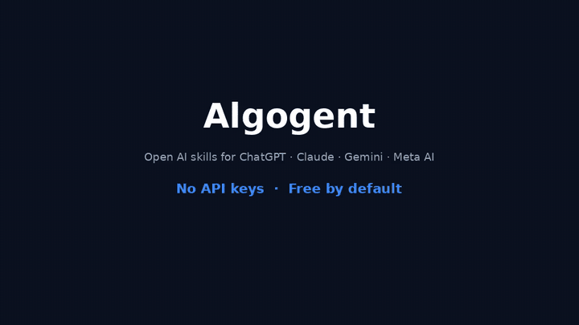

# Algogent

**Open, portable AI skills** that run on **ChatGPT, Claude, Gemini, and Meta AI** — using the accounts you already have.  
Many skills are **free**. Paid skills charge **only when a run succeeds**.

> Custom GPTs are locked to one vendor. Skills should be open, portable, and fair to creators.

[](LICENSE)
[](spec/README.md)
[](CONTRIBUTING.md)

---

## Why

| Problem | Algogent |
|---------|----------|
| Skills trapped in one chat product | **Open Skill Format** — one package, many runners |
| Re-setup when you switch models | Same skill on ChatGPT *and* Claude |
| Subscriptions for one-off tasks | **Free** or **pay per successful run** |
| Creators can’t earn across platforms | Optional pricing in the skill manifest |

---

## Demo

```text
Side panel → Summarize text (Free)
    → inject into active ChatGPT / Claude tab
    → success → no charge
```



Product walkthrough (HyperFrames): title → problem → free skills side panel → “Done · free skill · no charge” → Open Skill Format + repo CTA.

- **GIF:** `docs/assets/demo.gif` (commit the file from the generated asset if missing)
- **Full MP4:** see latest chat download / HyperFrames project `46c572c9-0100-4947-8155-635c3b41a345`

---

## Quick start

```bash
git clone https://github.com/shankarsai000/algogent.git
cd algogent
pnpm install
pnpm --filter @algogent/shared build
pnpm --filter @algogent/extension dev
```

1. Chrome → `chrome://extensions` → Developer mode → **Load unpacked** → WXT output folder  
2. Open [ChatGPT](https://chatgpt.com) or [Claude](https://claude.ai)  
3. Open the Algogent side panel → pick a **Free** skill → run  

**No wallet required** for free skills.

---

## Seed skills (free)

Summarize · Rewrite · Meeting notes → actions · PR review · Explain code · Commit message · Email reply · ELI5 · Bug bisect · SQL explain · Resume bullets · Regex helper · Threat model sketch · Formal translate · Blog/thread outline  

All packages: [`skills/`](skills/) · Spec: [`spec/`](spec/README.md)

---

## Open Skill Format

```text
skills/my-skill/
  manifest.json   # id, providers, pricing, inputs
  SKILL.md        # prompt with {{placeholders}}
```

Publish by PR. See [CONTRIBUTING.md](CONTRIBUTING.md).

---

## Payments (optional)

```text
success → shouldChargeOnResult → PaymentPlan → SettlementProvider → Receipt
```

Free skills (`amountMicro: 0`) never open a payment rail.  
Details: [docs/PAYMENTS.md](docs/PAYMENTS.md)

---

## Compare

| | Custom GPT / Gem | MCP only | **Algogent** |
|--|------------------|----------|--------------|
| Portable across chat UIs | No | N/A | **Yes** |
| Uses logged-in session | Yes | No | **Yes** |
| Success-gated micro-pay | No | DIY | **Yes** |
| Open skill packages | No | Partial | **Yes** |

---

## Docs

[Launch checklist](docs/LAUNCH_CHECKLIST.md) · [Show HN drafts](docs/SHOW_HN.md) · [Threat model](docs/THREAT_MODEL.md) · [Security](SECURITY.md)

## Status

Early public build. Provider DOMs change; adapters may need updates. Prefer free skills until settlement is production-hardened.

## License

MIT
